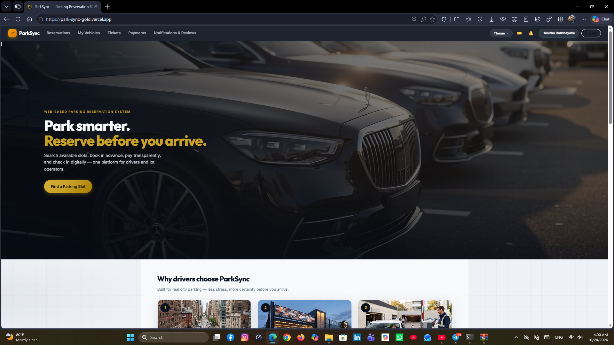
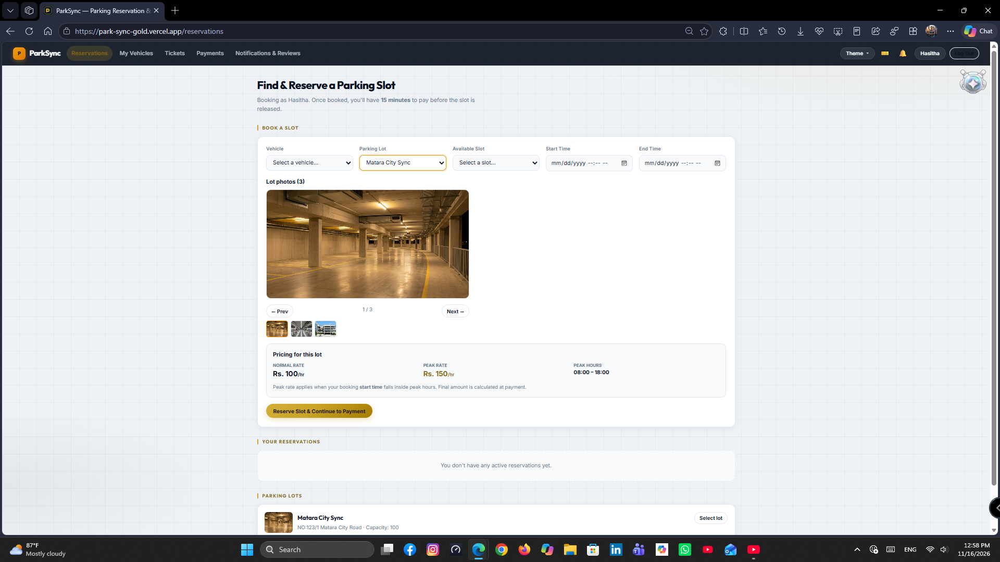
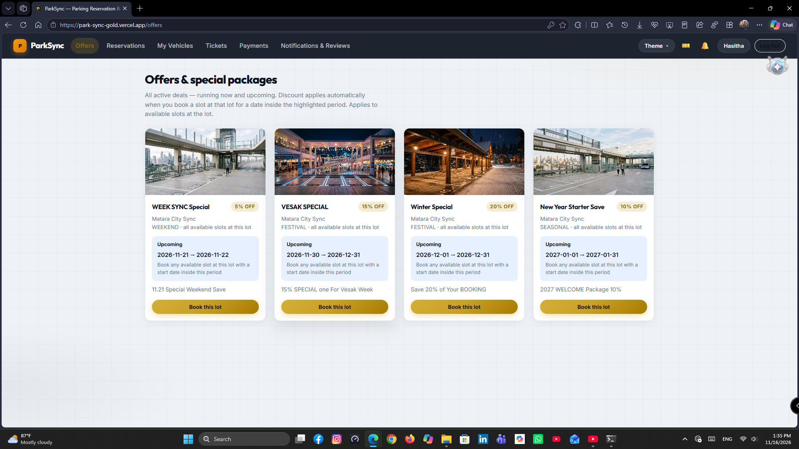

# ParkSync


**Web-Based Automated Parking Reservation and Management System**  
SE2030 Group Project · **26-MTR-SE2030-08**

ParkSync lets drivers search parking lots, reserve slots, pay online, and check in digitally.  
Lot admins manage slots, pricing rules, special packages, and day-to-day operations.

---

## Live demo

| Layer | URL |
|--------|-----|
| Frontend | https://park-sync-gold.vercel.app |
| Backend API | https://parksync-production.up.railway.app/api |

### Demo accounts

| Role | Email | Password |
|------|--------|----------|
| System Admin | `sysadmin@parksync.demo` | `ParkSync123` |
| Lot Admin | `lotadmin@parksync.demo` | `ParkSync123` |
| Attendant | `attendant@parksync.demo` | `ParkSync123` |
| Customer | Register on the site | your password |

---

## Features

- Role-based access: Customer, Lot Admin, Attendant, System Admin
- Parking lots and auto-named slots (`LOTNAME-01` pattern)
- Search, reserve, and change time/slot
- Dynamic pricing (normal / peak) and special packages
- Demo card payment flow (no real payment gateway)
- Digital tickets with check-in / check-out
- Lot photos and package images
- Notifications (unread count, delete, newest first)
- Public Offers page for active packages
- Live public stats on the landing page

---

## Tech stack

| Layer | Technology |
|--------|------------|
| Frontend | React + Vite |
| Backend | Spring Boot 3, Java 17, JPA/Hibernate |
| Database | MySQL 8 |
| Deploy | Vercel (frontend), Railway (backend) |

---

## Project structure

```text
parksync/
  frontend/     # React (Vite)
  backend/      # Spring Boot API
docs/
  screenshots/  # README images


More detail: see parksync/README.md [blocked].

Local development
Prerequisites

Java 17+
Node.js 18+
MySQL 8

Database
CREATE DATABASE IF NOT EXISTS parksync_db;

Backend
cd parksync/backend
# Set local DB user/password in src/main/resources/application.properties
./mvnw spring-boot:run
# API: http://localhost:8080/api

Frontend
cd parksync/frontend
npm install
npm run dev
# App: http://localhost:5173

Deployment

Frontend (Vercel): root directory = parksync/frontend
Env: VITE_API_URL = https://parksync-production.up.railway.app/api
Backend (Railway): root = parksync/backend
Set DB URL, username, password in Railway Variables (do not commit real secrets)
CORS allows local Vite ports and the Vercel domains

Modules (course mapping)
| # | Module | Backend package | Frontend |
| --- | --- | --- | --- |
| 1 | Slot Search & Reservation | reservation | ReservationPage.jsx |
| 2 | Parking Lot & Slot Management | parkinglot | ParkingLotAdminPage.jsx |
| 3 | Vehicle Check-in / Check-out | ticket | TicketPage.jsx |
| 4 | Billing & Payment | payment | PaymentPage.jsx |
| 5 | Dynamic Pricing & Packages | pricing | PricingPage.jsx |
| 6 | Notifications & Reviews | notification | NotificationReviewPage.jsx |

Screenshots
## Screenshots






Course: SE2030 · Project code: 26-MTR-SE2030-08

License
Academic project — for educational use only.


### 3.3 Quick check
Scroll the file — you should see sections down to **License**, not stop at Project structure.

---

Reply **“step 3 done”** when saved.  
Next = **STEP 4** (screenshots only).